                                                                                                                <!-- HEADER WAVE BANNER (BLACK & LIME GREEN) -->

<!-- DYNAMIC TYPING SUBTITLE (CYBER LIME) -->
                                                                                                                                  

<!-- VERIFIED CONTRIBUTOR BADGES (NO LOGOS) -->

<a href="https://github.com/angr/angr/pulls?q=is%3Apr+author%3Acodebyangelo+is%3Amerged">                                                                               </a>                                                              

                                                                                                                            
                                          
## Engineering Focus

Systems Security Engineer specializing in bridging **low-level systems engineering** (Linux kernel tracing, binary reverse engineering, memory safety) with **deterministic security guardrails for autonomous AI agents** (Model Context Protocol, AST verification, and fail-closed sidecars).
                                                                  Operating under an unyielding engineering creed:               
> *"Audit the system. Patch the boundary. Test the behavior. Preserve the semantics. Submit the smallest defensible change. Then repeat."*                                                            
---

## Merged Upstream Contributions
                                          
<table width="100%">
<tr>
<td width="33%" valign="top">                                                                                                       <h4><a href="https://github.com/angr/angr">angr / angr</a></h4>

<strong>Symbolic Execution &amp; Binary Analysis</strong>

<ul>
  <li><a href="https://github.com/angr/angr/pull/7353"><strong>PR #7353</strong></a>: Resolved unhandled <code>IndexError: bytearray index out of range</code> in <code>UltraPage</code> during symbolic memory state merging across 4096-byte page boundaries (Issue #6314).</li>
  <li>Enforced candidate offset clamping in <code>_ultra_changed_candidates</code>, aligned concrete chunk stepping, and hardened <code>_contains</code> with defensive out-of-bounds guards.</li>
  <li><strong>Test Suite:</strong> Multi-page regression coverage in <code>tests/storage/test_memory_merge.py</code>.</li>
</ul>

 

                                                                  </td>
<td width="33%" valign="top">                                     
<h4><a href="https://github.com/iovisor/bcc">iovisor / bcc</a></h4>

<strong>BPF Compiler Collection &amp; Kernel Tracing</strong>

<ul>
  <li><a href="https://github.com/iovisor/bcc/pull/5546"><strong>PR #5546</strong></a>: Migrated <code>tools/killsnoop</code> from brittle <code>sys_kill</code> kprobes to stable kernel tracepoints (<code>sys_enter_kill</code>, <code>tkill</code>, <code>tgkill</code>).</li>
  <li>Resolved breakage introduced in Linux 5.11+ (Issue #3592) and brought the Python implementation into direct parity with modern libbpf CO-RE tooling.</li>
  <li><strong>Test Suite:</strong> In-tree kernel tracepoint verification across modern kernels.</li>                               </ul>

 

</td>
<td width="33%" valign="top">

<h4><a href="https://github.com/radareorg/radare2">radareorg / radare2</a></h4>

<strong>UNIX-like Reverse Engineering Framework</strong>

<ul>                                                                <li><a href="https://github.com/radareorg/radare2/pull/27270"><strong>PR #27270</strong></a>: Fixed PDB <code>stream_file_get_size</code> intra-page calculation bug preventing Heap OOB reads up to 4KB per page traversed.</li>
  <li><a href="https://github.com/radareorg/radare2/pull/27060"><strong>PR #27060</strong></a>: Fixed Heap OOB read (CWE-125) in <code>rabin2</code> ELF section resize (<code>-O r</code>) &amp; permission patch.</li>
  <li><a href="https://github.com/radareorg/radare2/pull/26852"><strong>PR #26852</strong></a>: Fixed SIGSEGV type confusion (CWE-843) in PDB enum modifier pointer casting.</li>
  <li><a href="https://github.com/radareorg/radare2-testbins/pull/146"><strong>testbins #146</strong></a>: Upstreamed minimal binary test fixture.</li>                                               </ul>

 

                                                                  </td>
</tr>                                                             </table>

---

## CWE &amp; Vulnerability Remediations

* **CWE-125 (Out-of-Bounds Read):** Remediated in `radare2` ELF section resize (`rabin2 -O r`), enforcing cross-endian boundary clamping and fail-closed validation.
* **CWE-843 (Type Confusion):** Remediated in `radare2` PDB type parser, preventing SIGSEGV crashes during enum underlying type modifier casting (`eLF_MODIFIER`).
* **Intra-Page Buffer Desynchronization:** Eliminated up to 4KB per-page over-reporting in multi-page PDB stream reads (`radare2` `stream_file_get_size`), preventing potential Heap OOB reads.       * **IndexError Memory Page Crossing:** Remediated 4096-byte chunk calculation desynchronization in `angr` `UltraPage` symbolic memory state merging.

---

## Flagship Security Architectures

<table width="100%">                                              <tr>
<td width="50%" valign="top">
                                                                  <h4><a href="https://github.com/codebyangelo/project-moray">Project Moray</a></h4>                                                  
<strong>Ring 0 eBPF-LSM Containment Engine</strong>

<ul>                                                                <li>Sits beneath agent frameworks to terminate compromised processes, sever sockets, and drop network frames directly in kernel space via BPF-LSM and XDP.</li>
  <li>Pinned VFS map architecture linking user-space detections to Ring 0 enforcement with 0ms local lookups.</li>
  <li>Validated with an 82-test invariant suite &amp; MicroVM KVM kernel verification.</li>
</ul>

<code>eBPF</code> <code>BPF-LSM</code> <code>XDP</code> <code>C</code> <code>Ring 0 Containment</code>

</td>
<td width="50%" valign="top">

<h4><a href="https://github.com/codebyangelo/project_lobster_v0.4.0">Project Lobster</a></h4>

<strong>Context-Aware AI Agent Security Sidecar</strong>
   <ul>                                                                <li>Intercepts, inspects, and validates Model Context Protocol (MCP) tool invocations using per-session sliding-window tracking.</li>                                                                 <li>Hybrid defense pairing local deterministic "Iron Dome" rules with LLM intelligence under strict <strong>fail-closed</strong> security contracts.</li>
  <li>Hardened with Trivy container CI, AST sandboxes, and structured telemetry.</li>                                               </ul>                                                             
<code>MCP stdio</code> <code>AI Agent Defense</code> <code>Fail-Closed</code> <code>Python</code>
                                                                                              </td>                                                             </tr>
<tr>                                                              <td width="50%" valign="top">                                                                                                       <h4><a href="https://github.com/codebyangelo/project-mantis">Project Mantis</a></h4>

<strong>Autonomous DFIR Framework for SIFT Workstations</strong>

<ul>
  <li>Orchestrates Volatility 3 memory forensics and The Sleuth Kit (FLS) via a multi-agent Finite State Machine (FSM).</li>
  <li>Employs deterministic sieves and a <strong>"Hard Grounding" citation layer</strong> to eliminate LLM hallucinations in forensic investigations.</li>
  <li>Emits verifiable, audit-ready MITRE ATT&amp;CK incident reports.</li>                                                         </ul>                                                             
<code>DFIR</code> <code>Volatility 3</code> <code>Hard Grounding</code> <code>MITRE ATT&amp;CK</code>

</td>
<td width="50%" valign="top">                                                                                                       <h4><a href="https://github.com/codebyangelo/project-octopus-core">Project Octopus Core</a></h4>

<strong>Universal Security Verification &amp; Profiling Platform</strong>

<ul>
  <li>Platform-agnostic verification engine performing automated architecture discovery and dynamic AST fallback sandboxing.</li>     <li>Audits external codebases against NIST AI RMF, OWASP LLM Top 10, and CWE standards, emitting compliant SARIF 2.1.0 reports.</li>
  <li>Features modular language adapters for C, native binaries, and Python.</li>
</ul>

<code>SARIF 2.1.0</code> <code>AST Profiling</code> <code>NIST AI RMF</code> <code>OWASP Top 10</code>
                       
</td>
</tr>                                                             <tr>                                                              <td width="50%" valign="top">                                     
<h4><a href="https://github.com/codebyangelo/project-hermit">Project Hermit</a></h4>                                                
<strong>Autonomous Self-Optimizing Daemon &amp; Dynamic MCP Host</strong>

<ul>                                                                <li>Profiles, mutates, and verifies algorithms inside isolated RAM-disk sandboxes using AST mutators and Pareto optimization.</li>  <li>Autonomous thermal-trend scheduling and live introspection rollback guardrails with zero unverified regressions.</li>           <li>Serves dynamic MCP tools to connected agent clients.</li>   </ul>

<code>Autonomous Engine</code> <code>RAM-Disk Sandbox</code> <code>MCP Host</code> <code>Pareto</code>

</td>
<td width="50%" valign="top">
                        </td>                                                             </tr>                                                             </table>

---                                                                                                                             
## Technical Arsenal                                              

| Domain | Systems, Standards &amp; Toolchains |
| :--- | :--- |
| **Languages &amp; Kernel** | **C** (radare2 core, libbpf), **eBPF / BPF C** (BCC tracepoints, BPF-LSM, XDP), **Python 3** (multithreading, AST, ctypes), **Bash/POSIX**, **x86-64 Assembly** (<code>pt_regs</code>, System V ABI), **Rust** |
| **Security &amp; Auditing** | **CWE Remediation** (CWE-125 Heap OOB, CWE-843 Type Confusion, Integer Underflow), **AddressSanitizer (ASan)**, **Reverse Engineering** (radare2, rabin2), **Symbolic Execution** (angr, Claripy), **Fail-Closed Contracts** |
| **Agent Defense &amp; MCP** | **Model Context Protocol (MCP)** stdio / JSON-RPC 2.0, LLM Security Sidecars, Deterministic In-Kernel Guardrails, Anti-Hallucination Grounding, AST Sandboxes, **NIST AI RMF**, **OWASP Top 10 LLM** |                                  | **Forensics &amp; Systems** | **Linux Internals** (Debian, Alpine, Mint, SIFT, PRoot), **Kernel Tracing** (iovisor/bcc), **Memory/Disk Forensics** (Volatility 3, TSK fls/icat), **Binary Formats** (PDB / MSF 7.00, CodeView, ELF, MBR/GPT), **QEMU/KVM** |          | **Verification &amp; CI/CD** | **SARIF 2.1.0**, Build Systems (GCC, Clang, TCC, Meson, Ninja, Make), **Differential CI/CD** (Pytest, Ruff, Pylint, Pyright, GitHub Actions), Network Security (TCP/IP, UFW, nftables) |                                                                                                                 
                                                            
---                                                                                                                             
## Live Activity &amp; Velocity                                   

  
    

  

  <em>Currently open to full-time cybersecurity engineering opportunities in <strong>Systems Security, Binary Reverse Engineering, and AI Agent Infrastructure Defense</strong> (Remote Worldwide / EMEA or Relocation) - reach out via <a href="mailto:angeloayton@gmail.com">Email</a> or <a href="https://www.linkedin.com/in/angelo-ayton/">LinkedIn</a> to connect.</em>

 

<!-- FOOTER WAVE BANNER (BLACK & LIME GREEN) -->

